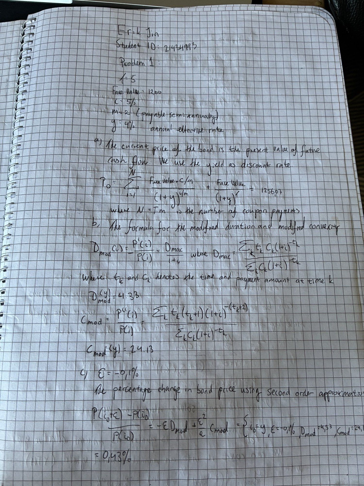
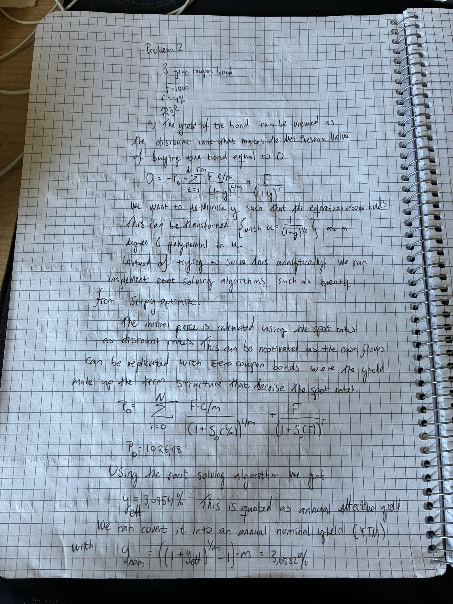
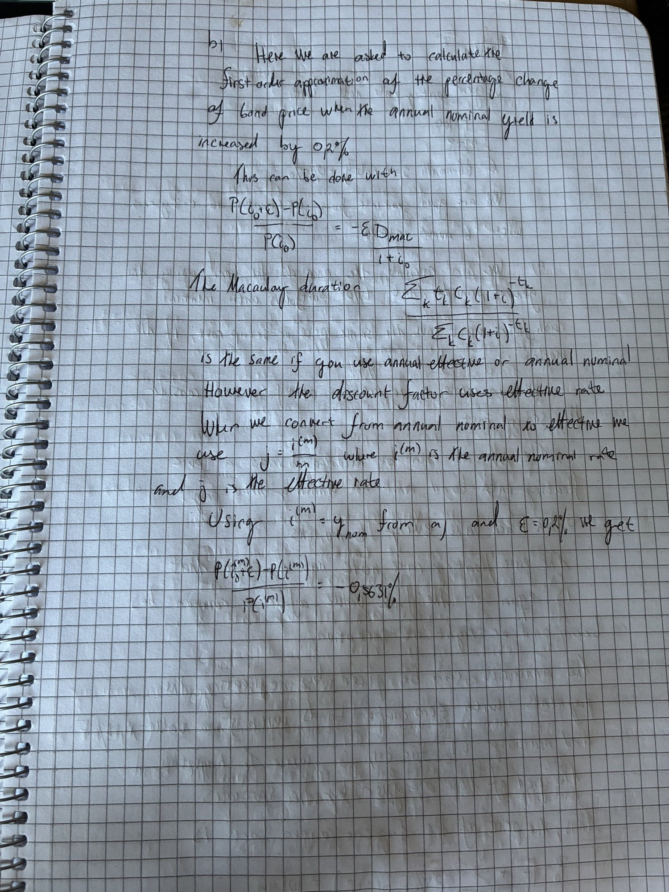
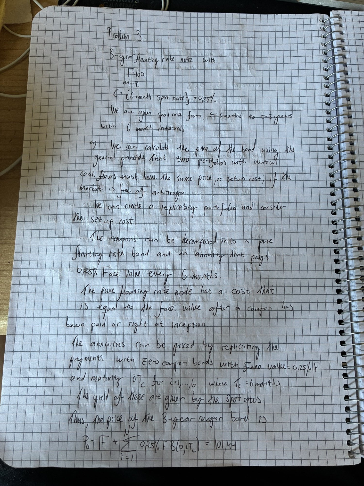
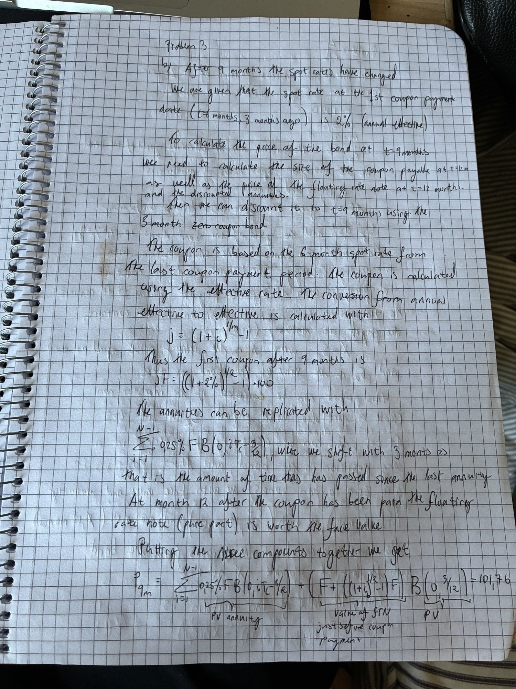
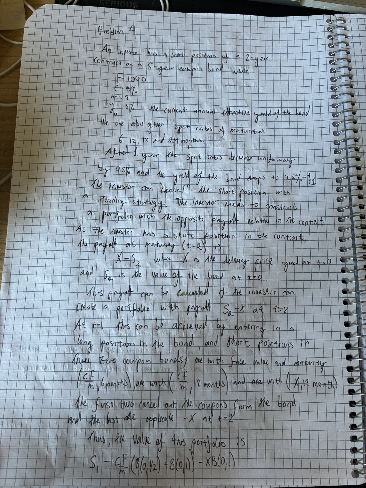
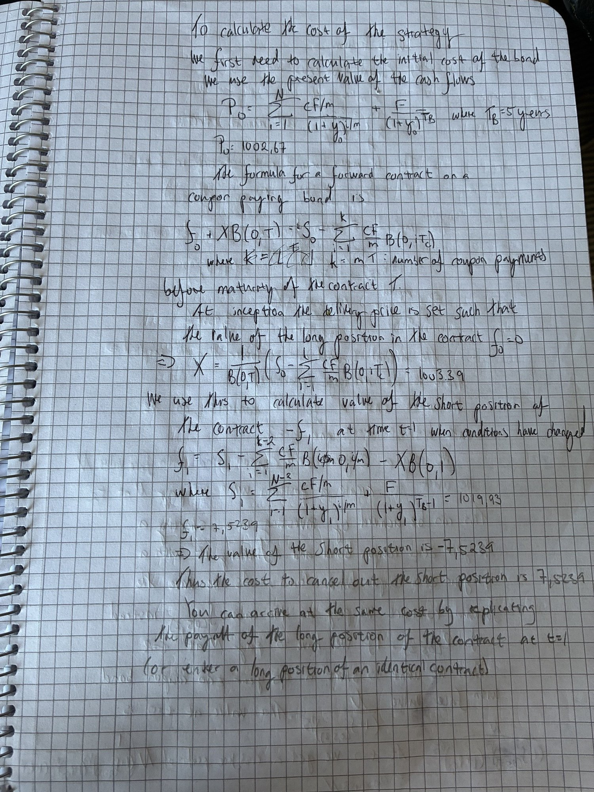
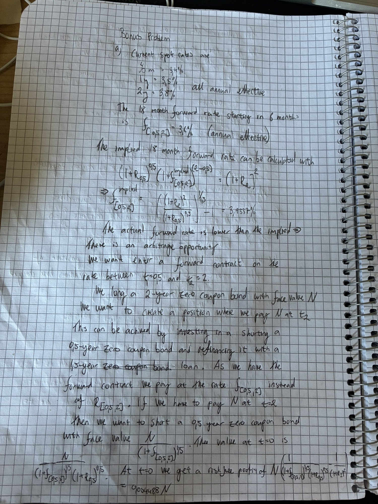
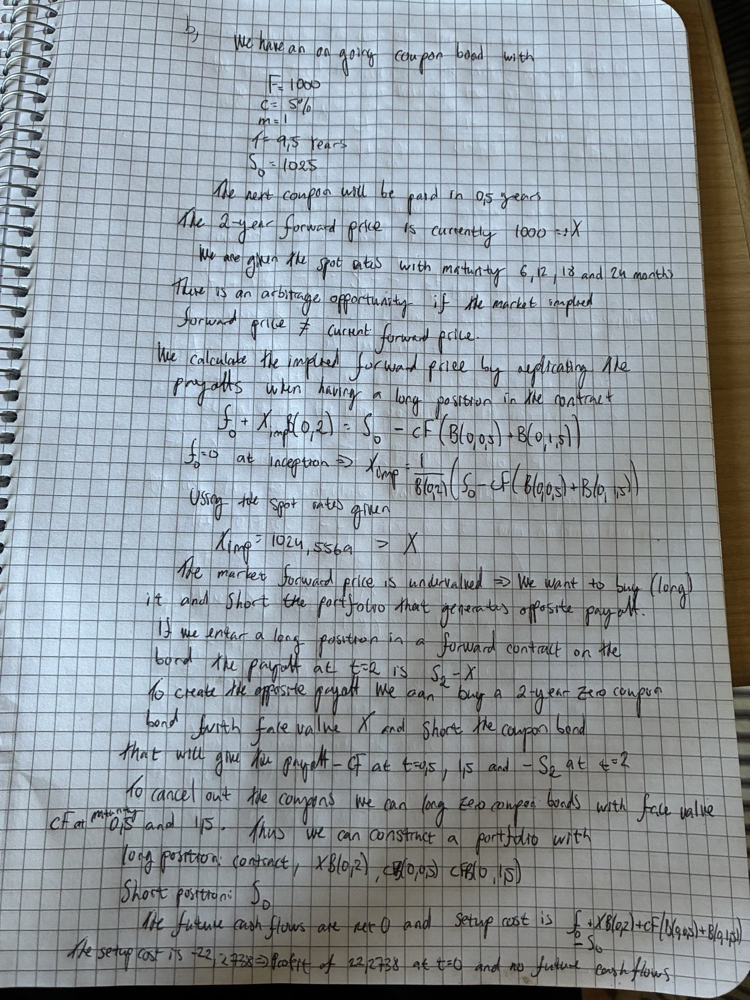

# MATH 4511 – Assignment 1

**Course:** MATH 4511 Quantitative Methods for Fixed Income Securities, 2026–2027 Fall
**Deadline:** 8 October 2026, 23:59 (Thursday), via Canvas
**Student:** Erik Jin

## Submission requirements

- Complete all required problems. Show full details: description of methods, key formulas and theorems used, and final answers. Marks are deducted for incomplete or unclear solutions; additional credit for well-written work.
- The submission must be **hand-written** (iPad is fine), in a **single PDF**, with full name and student ID on the first page.
- Late submissions are not accepted.

| Problem | Marks | Solution pages |
|---|---|---|
| 1 | 25 | page01 |
| 2 | 25 | page02, page03 |
| 3 | 25 | page04, page05 |
| 4 | 25 | page06, page07 |
| Bonus | 30 (optional) | page08, page09 |

Code for all numerical answers: `code/MATH4511_Assignment1.ipynb`. Submission PDF: `pdf/MATH4511_Assignment1_ErikJin.pdf`.

---

## Problem 1 (Required, 25 marks)

We consider a 5-year coupon bond issued today. The bond has face value $1200 and annual coupon rate 5 % payable semi-annually. The annual effective yield rate of the bond is currently 4 %.

- (a) Compute the current price of the bond.
- (b) Compute the modified duration and modified convexity of the bond (with respect to the annual effective yield rate).
- (c) Suppose that the annual effective yield rate of the bond is decreased by 0.1 %. Estimate the percentage change of the bond price using second-order approximation.

**Answers:** (a) 1256.07, (b) $D_{Mod} = 4.3264$, $C_{Mod} = 24.1333$, (c) +0.4338 %.

---

## Problem 2 (Required, 25 marks)

The following table shows the spot rates of various terms (all quoted as annual effective interest rates):

| Term | 3 m | 6 m | 9 m | 12 m | 15 m | 18 m | 21 m | 24 m | 27 m | 30 m | 33 m | 36 m |
|---|---|---|---|---|---|---|---|---|---|---|---|---|
| Spot rate | 2.1 % | 2.1 % | 2.2 % | 2.4 % | 2.4 % | 2.4 % | 2.6 % | 2.6 % | 2.9 % | 2.9 % | 2.9 % | 3.1 % |

We consider a 3-year coupon bond with face value $1000 and annual coupon rate 4 % payable semi-annually.

- (a) Calculate the yield rate of the bond. Give your answer as (i) annual effective yield rate and (ii) annual nominal yield rate.
- (b) (Harder) Using first-order approximation, estimate the percentage change of the bond price when the annual nominal yield rate is increased by 0.2 %. *(Hint: when calculating the modified duration, which yield rate, effective or nominal, should you consider?)*

**Answers:** price 1026.98; (a) (i) 3.0754 %, (ii) 3.0522 %; (b) −0.5632 % using $D_{Mod} = D_{Mac}/(1 + i^{(2)}/2)$.

---

## Problem 3 (Required, 25 marks)

We consider a 3-year floating rate note issued today. The face value is $100 and the coupon is paid semi-annually. The coupon rate over a coupon period is {6-month spot rate} + 0.25 %.

Current spot rates (annual effective):

| Term | 6 m | 1 y | 1.5 y | 2 y | 2.5 y | 3 y |
|---|---|---|---|---|---|---|
| Spot rate | 2 % | 2 % | 2.2 % | 2.4 % | 2.5 % | 2.8 % |

- (a) Compute the current price of the bond.
- (b) Suppose that the spot rates after 9 months are as follows (annual effective):

| Term | 3 m | 9 m | 15 m | 21 m | 27 m | 33 m |
|---|---|---|---|---|---|---|
| Spot rate | 1.8 % | 2 % | 2.3 % | 2.6 % | 2.7 % | 2.8 % |

  You are given that the 6-month spot rate at the first coupon payment date (3 months ago) is 2 % (annual effective). Calculate the bond price at that time.

**Answers:** (a) 101.44 (par + spread annuity), (b) 101.76.

---

## Problem 4 (Required, 25 marks)

Recently, an investor has entered into a **short** position of a 2-year forward contract on a 5-year coupon bond. You are given that

- the coupon bond has face value $1000 and annual coupon rate 5 % payable semi-annually,
- the current annual effective yield rate of the bond is 5 %,
- the current spot rates (annual effective) are

| Term | 6 m | 12 m | 18 m | 24 m |
|---|---|---|---|---|
| Spot rate | 4.4 % | 4.6 % | 4.8 % | 5.1 % |

After 1 year, the above spot rates decrease uniformly by 0.5 % and the yield rate of the bond becomes 4.5 %. The investor would like to "cancel" the short position of the contract. Suggest a trading strategy that achieves this and calculate the cost of setting up the strategy.

**Answers:** $S_0 = 1002.67$, $X = 1003.39$, $S_1 = 1019.93$, value of short position $-7.52$; cancel with a synthetic long forward (buy the bond, short zero-coupon bonds with face 25 at 1.5 y and 2 y and face $X$ at 2 y), cost 7.52.

---

## Bonus Problem (Optional, 30 marks)

### (a)

You are given that

- the current 6-month, 1-year and 2-year spot rates are 3.4 %, 3.5 % and 3.8 % respectively,
- the current 18-month forward rate starting in 6 months is $f_{[0.5,\,2]} = 3.6\,\%$,
- all rates are quoted as annual effective interest rates.

Identify an arbitrage opportunity. Explain your answer.

**Answer:** implied forward rate 3.9337 % > 3.6 %. Long 2-year zero, short 6-month zero with face $N = 1/(1+K)$, $K = 1.036^{1.5} - 1$, and long FRA at 3.6 %: risk-free profit 0.004488 per dollar at $t = 0$.

### (b)

We consider an on-going coupon bond with remaining life 9.5 years, face value $F = 1000$ and annual coupon rate 5 % payable annually. It is currently sold at $1025 and the next coupon is paid 6 months from today. Suppose that

- the 2-year forward price of the bond is currently $1000,
- the current spot rates (annual effective) are

| Term | 6 m | 12 m | 18 m | 24 m |
|---|---|---|---|---|
| Spot rate | 4.3 % | 4.4 % | 4.6 % | 5.0 % |

Identify an arbitrage opportunity. Explain your answer.

**Answer:** no-arbitrage forward price 1024.56 > 1000. Short the bond, long the forward, buy zeros with face 50 at 0.5 y and 1.5 y and face 1000 at 2 y: risk-free profit 22.27 at $t = 0$.

